<!--
  ===========================================================================
   Oussama Hmoute - GitHub profile
  ===========================================================================
   assets/            hand-written SVG (hero, universe, method, ecosystem,
                      closing, per-system architecture)
   assets/generated/  SVG produced by scripts/build_assets.py from live data.
                      Do not edit by hand; it is overwritten on the next run.
   config/profile.yml single source of truth for everything not fetched.
   scripts/           the generator: data layer, renderers, theme.
   .github/workflows/assets.yml  regenerates assets/generated on a schedule.
   docs/              how the profile is put together and how to maintain it.
  ===========================================================================
-->

  

  
    <a href="#engineering-universe">UNIVERSE</a> &nbsp;·&nbsp;
    <a href="#method">METHOD</a> &nbsp;·&nbsp;
    <a href="#technical-ecosystem">ECOSYSTEM</a> &nbsp;·&nbsp;
    <a href="#selected-systems">SYSTEMS</a> &nbsp;·&nbsp;
    <a href="#engineering-activity">ACTIVITY</a> &nbsp;·&nbsp;
    <a href="#current-experiments">EXPERIMENTS</a> &nbsp;·&nbsp;
    <a href="#contact">CONTACT</a>
  

  
    <a href="https://github.com/Hmoute-Oussama">GitHub</a> &nbsp;·&nbsp;
    <a href="https://www.linkedin.com/in/oussama-hmoute">LinkedIn</a> &nbsp;·&nbsp;
    <a href="mailto:oussamahmoutecrypto@gmail.com">Email</a>
  

I build systems that can prove their own claims, measure their own failures and explain what they did. Most of that work sits where software engineering, AI and security overlap: agents that must be held to evidence, pipelines that must be reconstructable, and infrastructure that must be observed.

---

## Engineering universe

  

Six domains, one loop. The labelled edges are hand-offs that happen in the work itself: a model gets adversarially tested, a release gets automated, a deployment gets observed, an incident turns into a design change.

## Method

  

Every system in this profile moves through the same loop, and the loop closes. Verification is the step that is not optional, which is why more than one of these repositories exists to make it harder to skip.

## Technical ecosystem

  

Six layers, one job each. A tool earns a place here only if it fits exactly one of them.

## Selected systems

Four systems with a spine: each one takes something people treat as trustworthy and makes it checkable.

### VERITY · the reality layer for AI coding agents

<a href="https://github.com/Hmoute-Oussama/VERITY"></a>

| | |
|:--|:--|
| **Problem** | A coding agent confidently reports work that is not present, tests that never ran and commands whose prerequisites do not exist. Claim and evidence get treated as the same thing. |
| **Pipeline** | CAPTURE → VERIFY → RECORD → INVALIDATE → GUARD, with re-verification whenever a dependency changes |
| **Decisions** | Statements are claims, never evidence · verifiers are deterministic, not model judgements · evidence is bound to the working tree · blocking is conservative · local-first SQLite store |
| **Stack** | Python 3.10+ · Typer · Rich · PyYAML · SQLite · MCP stdio server · GitHub Actions |
| **Status** | Published to PyPI as `verity-evidence` v1.0.0 · cross-platform CI on Linux, macOS and Windows · 36 verifiers · integration matrix across 10 repositories |
| **Source** | [Hmoute-Oussama/VERITY](https://github.com/Hmoute-Oussama/VERITY) |

### AgentSnap · unit tests for AI agents

<a href="https://github.com/Hmoute-Oussama/AgentSnap"></a>

| | |
|:--|:--|
| **Problem** | Agent behaviour is ordinary code that happens to be non-deterministic. Prompt edits, model updates and tool changes alter behaviour without touching a line of source, so regressions ship unnoticed. |
| **Pipeline** | RUN → RECORD → ASSERT → SNAPSHOT, with the baseline compared on every run |
| **Decisions** | Assertions, not vibes: every check has an exit code and a message · commands execute as argv, never through a shell · environment allow-list · paths resolving outside the sandbox are refused · secrets are redacted before anything is written |
| **Stack** | TypeScript · Node.js · GitHub composite action · Docker sandbox |
| **Status** | Distributed as the npm package `agentsnap` · three-layer suite (unit, integration against a deterministic fake provider, end-to-end on the built binary) so CI never spends a token |
| **Source** | [Hmoute-Oussama/AgentSnap](https://github.com/Hmoute-Oussama/AgentSnap) |

### CI/CD Visualizer · flight recorder for pipelines

<a href="https://github.com/Hmoute-Oussama/CI-CD-VISUALIZER"></a>

| | |
|:--|:--|
| **Problem** | CI/CD is a black box you debug by scrolling YAML and logs. There is no execution model, no recording and no way to ask why a run was slow. |
| **Pipeline** | COLLECT → REDUCE → PROJECT, replayable from the recorded log alone |
| **Decisions** | Events are the only source of truth and the UI never talks to GitHub · the execution model is a pure function of events, so replay is free · a new CI provider is a new collector and nothing else changes · runs persist as a JSONL flight recorder |
| **Stack** | TypeScript · npm workspaces · Node.js · Express · ws · React 18 · Vite · zustand |
| **Status** | v0 with a simulator collector and a GitHub webhook collector · hand-rolled SVG pipeline graph · automated performance-regression detection |
| **Source** | [Hmoute-Oussama/CI-CD-VISUALIZER](https://github.com/Hmoute-Oussama/CI-CD-VISUALIZER) |

### CrisisMesh · noisy crisis reports into a verifiable situation graph

<a href="https://github.com/Hmoute-Oussama/CrisisMesh-Apertus"></a>

| | |
|:--|:--|
| **Problem** | During a crisis, reports are noisy, duplicated, contradictory and partly adversarial. Naive extraction fabricates counts and mis-types resources. |
| **Pipeline** | INTAKE → EXTRACT → GUARD → RECONCILE → GRAPH, with unverified nodes re-entering reconciliation |
| **Decisions** | Grammars are generated from the taxonomy rather than written by hand · the model abstains instead of guessing · raw text is immutable at the database layer · truth is measured, not asserted |
| **Stack** | Python · FastAPI · SQLAlchemy · NetworkX · llama.cpp GGUF · GBNF grammars |
| **Status** | Truth Preservation Score 0.8433 with a grounding rate of 1.0 on the demo scenario · contradiction detection and cross-language place identity in place · dashboard pending |
| **Source** | [Hmoute-Oussama/CrisisMesh-Apertus](https://github.com/Hmoute-Oussama/CrisisMesh-Apertus) |

### Foundations

Lower to the metal, and where the habits come from.

| System | Language | What it is |
|:--|:--|:--|
| [wireshark-clone](https://github.com/Hmoute-Oussama/wireshark-clone) | C++ | packet capture and dissection engine |
| [SGF file system](https://github.com/Hmoute-Oussama/Un-mini-Syst-me-de-Gestion-de-Fichiers-SGF-en-C-) | C++ | file and directory manager with an on-disk layout |
| [wirehack](https://github.com/Hmoute-Oussama/wirehack) | C, Makefile | wireless network security tooling |
| [projet-reseau-NFV](https://github.com/Hmoute-Oussama/projet-reseau-NFV) | PHP | network function virtualisation exercise |
| [CyberLab](https://github.com/Hmoute-Oussama/CyberLab) | Java | security lab utilities |

## Engineering activity

Read from the GitHub REST API and the public contribution graph every time the workflow runs. No estimates, no third-party card services, no numbers this repository cannot reproduce.

  

  

  

How these three panels are produced

`scripts/build_assets.py` fetches the profile, the repositories and the contribution graph, then hands them to the renderers in `scripts/render.py`. Every fetcher returns `None` on failure instead of raising, and a renderer that receives `None` draws an explicit "unavailable" panel. That is deliberate: a bad API day leaves the previous, still-correct asset in place and publishes no invented figure.

The assets carry no wall-clock timestamp. The "as of" marker is derived from the data (the newest push, the newest contribution), so a scheduled run only produces a commit when something genuinely changed.

Full detail in [docs/ARCHITECTURE.md](docs/ARCHITECTURE.md) and [docs/MAINTENANCE.md](docs/MAINTENANCE.md).

## Current experiments

  

The list lives in [config/profile.yml](config/profile.yml) and the panel is regenerated on push. Short-lived threads are removed rather than allowed to rot.

## Contact

  

  
    <a href="https://github.com/Hmoute-Oussama">github.com/Hmoute-Oussama</a> &nbsp;·&nbsp;
    <a href="https://www.linkedin.com/in/oussama-hmoute">linkedin.com/in/oussama-hmoute</a> &nbsp;·&nbsp;
    <a href="mailto:oussamahmoutecrypto@gmail.com">oussamahmoutecrypto@gmail.com</a>
  

Open to problems that reward verification: agent reliability, CI/CD observability, secure delivery, distributed backends.
